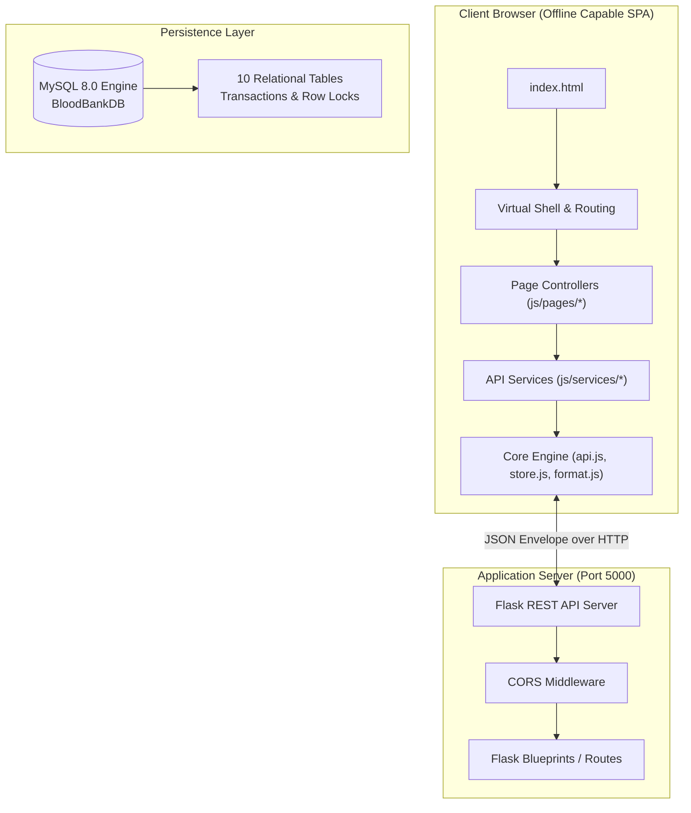
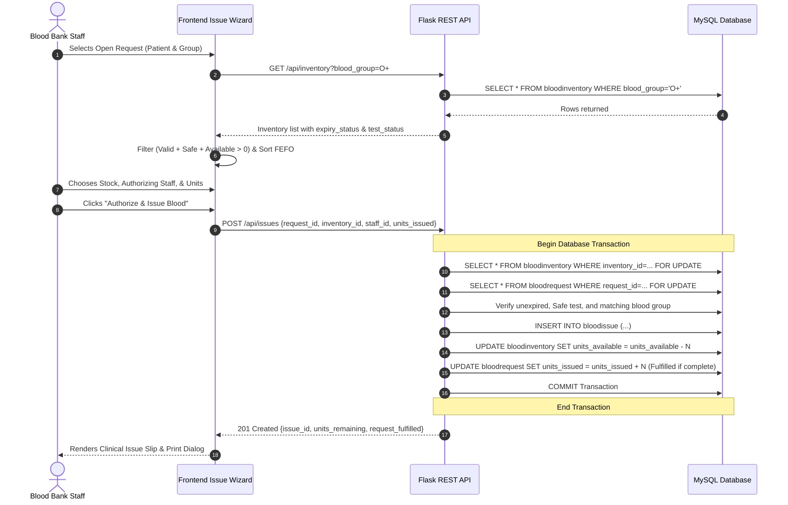

# System Architecture & Lifecycle Specification

## 1. Multi-Tier Architecture

---

## 2. End-to-End "Issue Blood" Transaction Flow

---

## 3. Frontend Architecture Layers

1. **Pages Layer (`js/pages/*`)**: View controllers responsible for rendering DOM subtrees, binding user interactions, and triggering workflows. Never issues raw `fetch` calls.
2. **Services Layer (`js/services/*`)**: Thin API client wrappers created using `createResource` factory. Manages pagination parameters and lookup cache invalidations.
3. **Core Layer (`js/core/*`)**: Zero-dependency framework abstractions:
   - `api.js`: Envelope unboxing, status extraction, network error transformation, and request aborting.
   - `router.js`: Hash-based SPA routing with query string synchronization.
   - `dom.js`: Secure element builders that escape untrusted strings by construction.
   - `format.js`: Date arithmetic, relative time formatting, and number localization.
   - `store.js`: LocalStorage preference caching with fallback.
   - `events.js`: Pub/sub event bus decoupling services from view updates.
4. **UI Components Layer (`js/ui/*`)**: Generic, resource-agnostic widgets: data table, form dialog, modal, drawer, toast, status badges, pagination, and searchable comboboxes.
